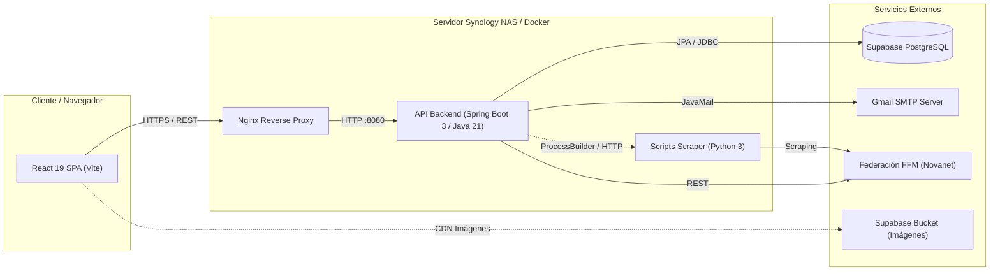

<div align="center">

  

  # Real Lisiados FS — WebApp Oficial

  **Plataforma integral de gestión deportiva, estadísticas avanzadas, actas federativas y comunidad para el club Real Lisiados Fútbol Sala.**

  [](CHANGELOG.md)
  [](https://github.com/tu-usuario/RELI-WebApp/actions)
  [](api-backend/src/test)
  [](#-licencia-y-derechos-de-autor)

  [🌐 Ver Web en Producción](https://reallisiados.duckdns.org/) • [📋 Ver Changelog](CHANGELOG.md) • [🚀 Próximas Mejoras](PROXIMAS_MEJORAS.md) • [📖 Documentación TDD](DOCUMENTACION.md)

</div>

---

## 📑 Tabla de Contenidos

- [🎯 Visión General](#-visión-general)
- [🏷️ Estado del Proyecto y Versionado](#-estado-del-proyecto-y-versionado)
- [⚡ Características Principales](#-características-principales)
- [🏗️ Arquitectura y Tecnologías](#-arquitectura-y-tecnologías)
- [📁 Estructura del Repositorio](#-estructura-del-repositorio)
- [🚀 Puesta en Marcha Local](#-puesta-en-marcha-local)
  - [Prerrequisitos](#prerrequisitos)
  - [Variables de Entorno](#variables-de-entorno)
  - [Backend (Spring Boot)](#1-backend-api-spring-boot)
  - [Frontend (React + Vite)](#2-frontend-spa-react--vite)
  - [Scripts de Scraping (Python)](#3-scripts-de-scraping-python)
- [🚢 Despliegue y CI/CD](#-despliegue-y-cicd)
- [🤝 Contribución](#-contribución)
- [🔒 Licencia y Derechos de Autor](#-licencia-y-derechos-de-autor)

---

## 🎯 Visión General

**RELI-WebApp** es la solución tecnológica oficial del club **Real Lisiados FS**. Diseñada para cubrir todo el ciclo de vida del club: desde la sincronización automática de partidos y actas con la **Federación de Fútbol de Madrid (FFM / Novanet)**, hasta la interacción directa con la afición mediante votaciones de quintetos ideales, cobertura de noticias, perfiles de jugadores y notificaciones automáticas por correo electrónico de horarios confirmados.

---

## 🏷️ Estado del Proyecto y Versionado

El proyecto sigue un esquema de versiones estructurado en formato **`1.MM.DD`**:
* **`1`**: Versión principal de la plataforma.
* **`MM`**: Mes de la entrega (ej. `11` = Noviembre).
* **`DD`**: Día de la release o iteración (ej. `16`).

### 📌 Versión Actual: `v1.11.16` (16 de Noviembre de 2026)

| Versión | Fecha | Estado | Hitos Clave |
| :--- | :--- | :--- | :--- |
| **`v1.11.16`** | 16/11/2026 | **Producción** | Blindaje de partidos manuales (`manual=true`), corrección de scraping por tarjetas aisladas, actas federativas sin cruce de rivales, sincronización SMTP de Gmail y timeouts. |
| **`v1.11.15`** | 15/11/2026 | Desplegado | Soporte multitorneo/copas, partidos de fase de grupos, formato horario español y refuerzo de seguridad en Nginx. |
| **`v1.10.24`** | 24/10/2026 | Desplegado | Votaciones de quinteto de la jornada, panel de administración con preview de correos e integración con Supabase Storage. |
| **`v1.10.16`** | 16/10/2026 | Desplegado | Sistema de notificaciones por email, registro con verificación y recuperación de contraseña. |

> Consulta el historial exhaustivo y los cambios detallados en [CHANGELOG.md](CHANGELOG.md).

---

## ⚡ Características Principales

### ⚽ Competición y Calendario Inteligente
- **Sincronización Federativa (FFM / Novanet):** Scraper automatizado y manual que descarga calendarios, campos, fechas, horas y resultados oficiales.
- **Protección de Ediciones Manuales (`manual=true`):** Los partidos creados o editados manualmente por los administradores nunca son sobrescritos por el scraper.
- **Aislamiento de Marcadores:** Extracción de resultados bloque por bloque de tarjeta federativa, evitando contaminaciones entre partidos concurrentes.
- **Actas Oficiales Detalladas:** Asignación individualizada de goles, minutos, amonestaciones y asistencias exclusivamente a jugadores del club, conservando MVPs y asistencias manuales.

### ⭐ Quinteto de la Jornada (Fan Zone)
- Votación interactiva para que los aficionados elijan su alineación ideal (1 Portero, 1 Cierre, 2 Alas y 1 Pívot).
- Restricción de 1 voto por usuario autenticado por cada jornada disputada.
- Computación de resultados en vivo y podio de MVPs de la temporada.

### 👥 Plantilla y Analítica Deportiva
- Perfiles de jugadores con dorsales históricos, posición, biografía y foto oficial.
- Estadísticas agregadas por temporada y competición: goles, asistencias, tarjetas amarillas/rojas, partidos jugados y ratio de victorias.

### 📧 Notificaciones Automatizadas (Gmail SMTP)
- Aviso automático a todos los usuarios verificados tan pronto como la Federación fija la hora y el campo de juego.
- Emails transaccionales con plantilla responsive HTML y escudo corporativo embebido (verificación de cuenta, cambio de contraseña, avisos de partidos).

### 🎛️ Panel de Administración Integral (Backoffice)
- Gestión completa (CRUD) de Temporadas, Competiciones (Liga y Copas), Partidos, Plantilla, Noticias y Usuarios.
- Monitor de sincronización con la Federación y centro de pruebas SMTP con previsualización en vivo.

---

## 🏗️ Arquitectura y Tecnologías

El sistema utiliza una arquitectura desacoplada y contenerizada, desplegada en infraestructura de alta disponibilidad:



### Stack Técnico

| Capa | Tecnologías |
| :--- | :--- |
| **Frontend** | React 19, Vite 8, Tailwind CSS, Heroicons, Framer Motion |
| **Backend** | Java 21 (LTS), Spring Boot, Spring Security (JWT HS256), Spring Data JPA, Hibernate, Caffeine Cache |
| **Base de Datos** | PostgreSQL (Supabase Transaction Pooler con SSL) |
| **Automatización** | Python 3, Requests, BeautifulSoup / Regex Scrapers |
| **Email** | JavaMailSender, Angus Mail, Gmail SMTP con TLS |
| **Contenedores y CI/CD** | Docker, Docker Compose, GitHub Actions, GHCR (GitHub Container Registry) |

---

## 📁 Estructura del Repositorio

```text
RELI-WebApp/
├── api-backend/               # Servicio REST en Spring Boot (Java 21)
│   ├── src/main/java/         # Código fuente (Controllers, Services, Models, DTOs, Security)
│   ├── src/main/resources/    # application.properties, plantillas de correo y assets
│   ├── src/test/              # Suite de 64 tests de integración y unitarios
│   ├── pom.xml                # Gestión de dependencias Maven
│   └── Dockerfile             # Imagen multi-stage en Eclipse Temurin 21 Alpine
├── reli-frontend/             # Aplicación SPA en React 19 + Vite 8
│   ├── src/components/        # Componentes UI (Admin, Layout, Tarjetas, Modales)
│   ├── src/pages/             # Vistas de usuario y panel de administración
│   ├── src/services/api.js    # Capa de consumo del API REST
│   └── Dockerfile             # Nginx Alpine sirviendo el bundle optimizado
├── scripts/                   # Automatizaciones de scraping federativo (FFM / Novanet)
│   ├── ffmadrid.py            # Scraper de jornadas, campos, horarios y resultados
│   ├── ffmadrid_acta.py       # Descarga del acta oficial
│   └── ffmadrid_acta_import.py# Importador de estadísticas a la base de datos
├── nas-deploy/                # Manifiestos de despliegue para Synology NAS DSM
├── .github/workflows/         # Pipelines de CI (Test/Lint) y CD (Build/Deploy a GHCR)
├── CHANGELOG.md               # Registro histórico de versiones
├── PROXIMAS_MEJORAS.md        # Backlog técnico priorizado
└── DOCUMENTACION.md           # Documento de diseño técnico y flujo de trabajo
```

---

## 🚀 Puesta en Marcha Local

### Prerrequisitos
- **Java 21 JDK** (recomendado Eclipse Temurin u OpenJDK).
- **Node.js 20+** y `npm`.
- **Python 3.10+** (para los scripts de federación).
- **Git**.

---

### Variables de Entorno

Crea tu archivo `.env` tomando como referencia `api-backend/.env.example`:

```bash
# Copia la plantilla en backend y frontend
cp api-backend/.env.example api-backend/.env
```

Configura en `api-backend/.env` tus credenciales:
```properties
DB_PASSWORD=tu_password_supabase
JWT_SECRET=tu_secreto_seguro_de_al_menos_32_caracteres
EMAIL_ENABLED=true
GMAIL_USER=tu_correo@gmail.com
GMAIL_PASSWORD=xxxx xxxx xxxx xxxx   # Contraseña de aplicación de 16 caracteres
FFM_USER=tu_usuario_ffm
FFM_PASS=tu_clave_ffm
FFM_DEVICE_ID=4a5c8120-e71c-4b53-9a3b-21a4f0de74b9
FRONTEND_URL=http://localhost:5173
```

---

### 1. Backend API (Spring Boot)

```bash
cd api-backend

# Ejecutar la suite completa de pruebas
./mvnw clean test

# Arrancar el servidor de desarrollo
./mvnw spring-boot:run
```
> La API estará disponible en `http://localhost:8080/api` y la documentación Swagger en `http://localhost:8080/swagger-ui.html`.

---

### 2. Frontend SPA (React + Vite)

```bash
cd reli-frontend

# Instalar dependencias
npm install

# Compilar para verificar TypeScript / JSX
npm run build

# Arrancar el entorno de desarrollo con Hot Reload
npm run dev
```
> Abre tu navegador en `http://localhost:5173`.

---

### 3. Scripts de Scraping (Python)

```bash
cd scripts
pip install -r requirements.txt

# Probar la lectura de una jornada federativa concreta
python ffmadrid.py --jornada 1
```

---

## 🚢 Despliegue y CI/CD

El proyecto utiliza un pipeline continuo automatizado en **GitHub Actions**:

1. **Integración Continua (`ci.yml`):**
   - Ejecución obligatoria de la suite de 64 pruebas unitarias e integradas con Maven.
   - Linting de ESLint y comprobación de build de producción con Vite.
2. **Entrega Continua (`cd.yml`):**
   - Empaquetado automático de imágenes Docker multi-arquitectura.
   - Publicación directa en **GHCR** (`ghcr.io/adriijg/reli-backend` y `reli-frontend`).
   - Notificación y despliegue automatizado en el **NAS Synology** mediante Docker Compose.

---

## 🤝 Contribución

1. Haz un fork del repositorio.
2. Crea una rama descriptiva para tu cambio:
   ```bash
   git checkout -b feature/nueva-funcionalidad
   ```
3. Realiza tus commits siguiendo la convención de [Conventional Commits](https://www.conventionalcommits.org/):
   ```bash
   git commit -m "feat: añadir filtro por temporada en calendario"
   ```
4. Sube tu rama y abre un Pull Request hacia la rama `develop`:
   ```bash
   git push origin feature/nueva-funcionalidad
   ```

---

## 🔒 Licencia y Derechos de Autor

**Copyright © 2026 Adrián Junquera / Real Lisiados FS. Todos los derechos reservados.**

Este proyecto, su código fuente, arquitectura, diseño y elementos gráficos son de **propiedad exclusiva**. Queda prohibida su copia, redistribución, modificación o explotación comercial o privada por terceros sin el consentimiento expreso y por escrito del autor.

---

<div align="center">
  <sub>Desarrollado con ❤️ y pasión por el fútbol sala para el <strong>Real Lisiados FS</strong>.</sub>
</div>
